# Tissue

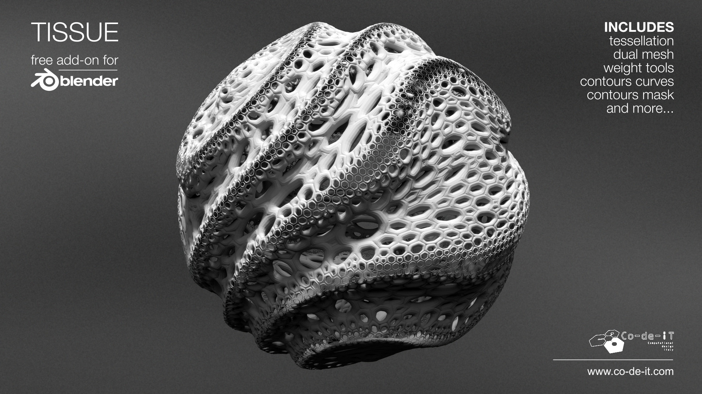

**Tissue** is a set of computational design tools for Blender. It lets you build complex, pattern-based geometry procedurally: you repeat components over surfaces, turn meshes into their duals, and control shapes with data stored on the mesh, such as vertex groups, colours and materials.

At the core of the add-on is **Tessellate**. It copies a component object onto every face of a base mesh, deforming each copy to fit its face. The result is non-destructive and stays linked to its inputs, so you can edit the base, the component or the settings and refresh the result at any time. Vertex groups, shape keys, materials and iterations let a single pattern change in thickness, shape and type across the surface. This makes it possible to create lattices, panels, scales, weaves and other structures that would be slow or impossible to model by hand.

Tissue also includes tools for working with vertex data. In Weight Paint mode you can:

- **Generate weights** from surface properties such as area, curvature, distance and deformation, or from your own formulas.
- **Use weights to drive geometry**: draw contour curves, displace or mask the surface, or grow organic patterns with a Reaction-Diffusion simulation.
- **Convert between data types**: weights, vertex colours, materials and UVs.

Together these tools support a workflow inspired by architecture, fabrication and generative art. In it, geometry is the result of rules and relationships rather than manual modelling. Tissue is useful for designers, architects, jewellers and artists who want to explore complex forms, and for anyone preparing geometry for 3D printing or digital fabrication.

The tools are in the *Tissue* tab of the 3D Viewport sidebar, and change with the active mode:

- [Tissue Tools](#tissue-tools) (Object Mode and Edit Mode)
- [Tissue Weight Tools](#tissue-weight-tools) (Weight Paint Mode)
- [Tissue Color Tools](#tissue-color-tools) (Vertex Paint Mode)

## Contents

- [Installation](#installation)
- [Tissue Tools](#tissue-tools)
- [Tissue Weight Tools](#tissue-weight-tools)
- [Tissue Color Tools](#tissue-color-tools)
- [Video Tutorials](#video-tutorials)
- [Credits](#credits)

## Installation

Tissue is available on the [Blender Extensions platform](https://extensions.blender.org/add-ons/tissue/).

1. In Blender, open *Edit > Preferences > Get Extensions*.
2. Search for **Tissue** and click *Install*.

To install a release from [GitHub](https://github.com/alessandro-zomparelli/tissue/releases) instead, drag the downloaded `.zip` file into Blender, or use *Install from Disk* in the drop-down menu at the top right of *Get Extensions*.

## Tissue Tools

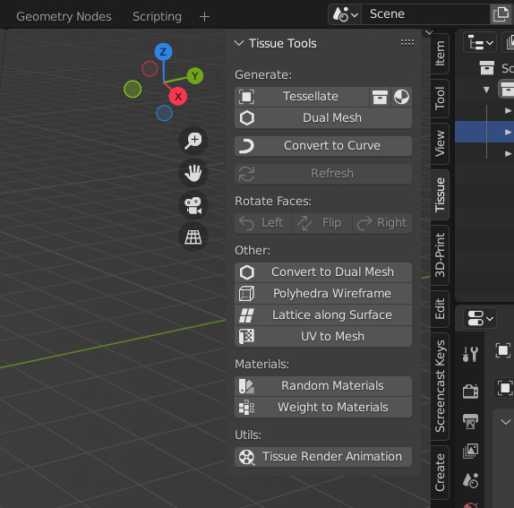

### Generators

*Generators* are non-destructive functions that create new objects from input objects. They include **Tessellate**, **Dual Mesh** (a special Tessellate) and **Convert to Curve**. For all of them, the **Refresh** operator reloads the changes from the input objects.

### Tessellate

The *Tessellate* tool copies a selected object (the *Component*) onto the faces of the active object (the *Base*), fitting the component's bounding box to the shape of each quad face. *Mesh*, *Curve*, *Surface*, *Text* and *Meta* objects can all be used as inputs. Tessellate needs two selected objects. After pressing the *Tessellate* button, more options appear in the operator's parameters.

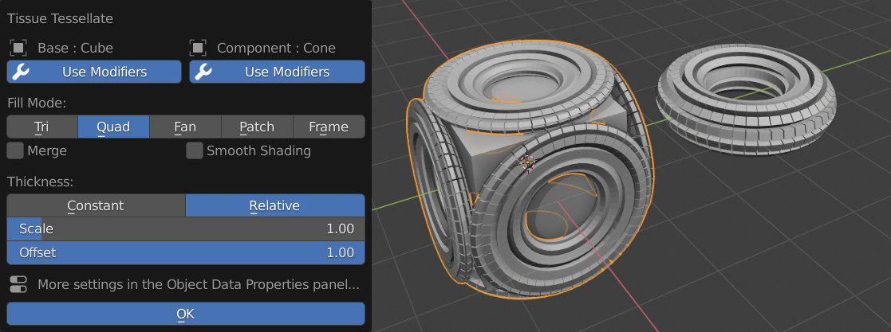

You can change them later, together with more advanced settings, from the *Object Data* panel of the generated object.

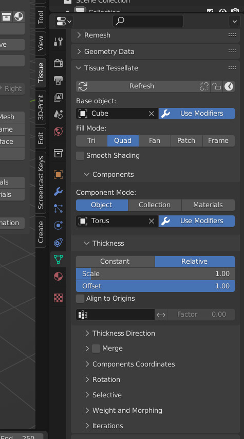

**Use Modifiers**: available for both the *Base* and the *Component* objects; uses their modifiers. When disabled, only the original object data is used.

**Fill Mode**: the strategy used to map the Component's coordinates onto the Base's faces.

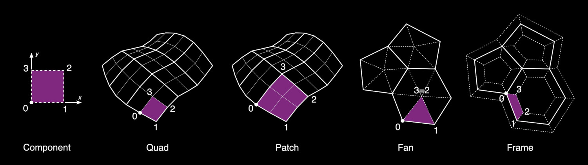

- **Tri**: triangulates the Base object and maps the component onto the triangular faces. The input domain is still rectangular, but the target domain has two coincident vertices.
- **Quad** (default): maps the Component domain onto each quad face of the Base object. Faces with more than 4 vertices are automatically split into quads or triangles.

  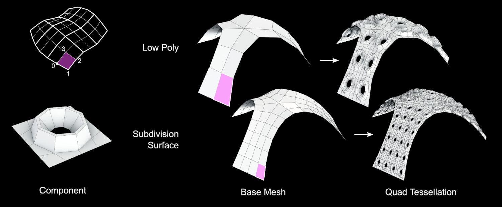

- **Fan**: splits every face of the Base object into triangles, connecting each side of the face to its centre.

  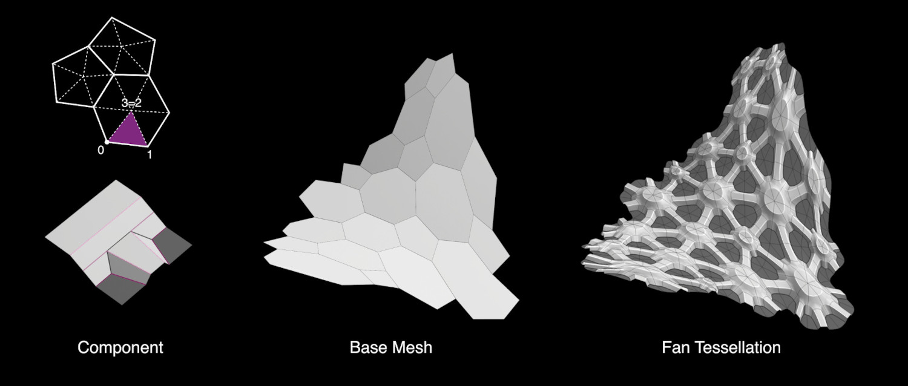

- **Patch**: requires a Subdivision Surface modifier on the Base object. Similar to *Quad*, but uses curved domains based on the subdivided patches. If there are several Subdivision Surface (or Multiresolution) modifiers, only the last one defines the target patches.

  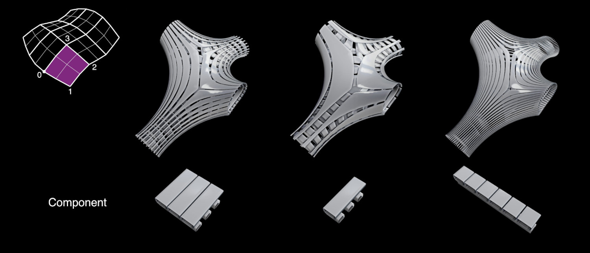

- **Frame**: like the *Inset Faces* operator, places the components along offset faces of a given thickness.

  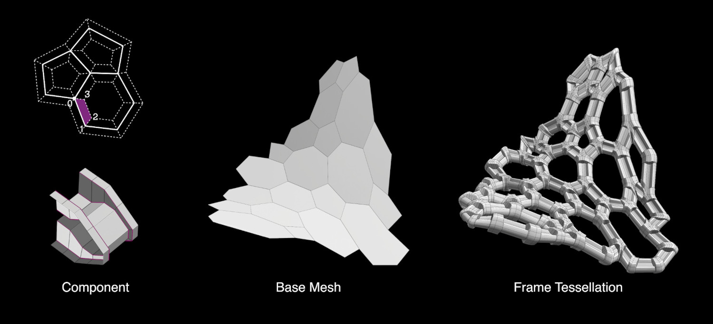

**Merge**: merges all the generated components together.

**Smooth Shading**: sets the shading of the generated geometry to smooth. Not needed if the Component object is already smooth.

**Components**: three methods can be used to assign the components:

- **Object**: repeats the same object on all the target faces.
- **Collection**: uses the objects in a given collection, assigned either randomly or according to a vertex group.
- **Materials**: assigns the components according to the names of the materials of each face. If no object has the same name as a material, the faces with that material are not used. Watch the [tutorial](https://youtu.be/9RDIQvBB8XQ).

**Thickness**

- **Scale Mode**
  - **Constant**: generates components with a fixed, uniform thickness in the normal direction.
  - **Relative**: generates components with a thickness proportional to the size of the target face, keeping an aspect ratio similar to the original Component object.
- **Scale**: the scaling factor of the components' thickness.
- **Offset**: the alignment of the components relative to the surface of the Base object.

**Component Coordinates**: the strategy used to define the component's domain when mapping it onto the target faces.

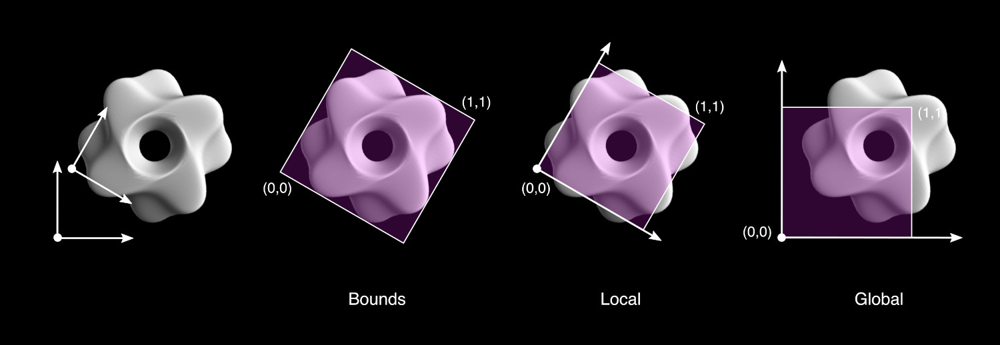

- **Bounds** (default): uses the *Bounding Box* of the component object as its domain.
- **Local**: uses the local coordinates of the component object. The face domain goes from 0 to 1 in both the local X and Y directions. This allows custom mappings, and keeps the result independent of the component's location, rotation and scale.
- **Global**: like *Local*, but based on the global coordinates of the component. This makes it easy to animate the result by changing the component's location, rotation and scale. Watch the [tutorial](https://youtu.be/PRIcB1Q-gK4).

With *Local* and *Global* coordinates, the parts of the component outside the 0–1 domain can be handled in three ways:

- **Extend**: keeps them, extending the component beyond the face.
- **Clip**: truncates the component at the 0–1 domain.
- **Cyclic**: cuts them and moves them to the opposite side of the domain.

  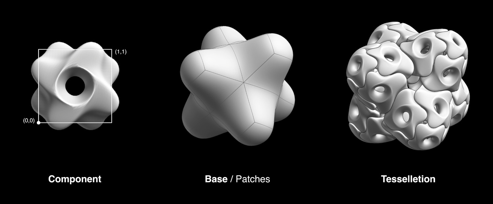

**Weight and Morphing**: combines the vertex groups of the Base object with the shape keys of the Component, to generate morphing components.

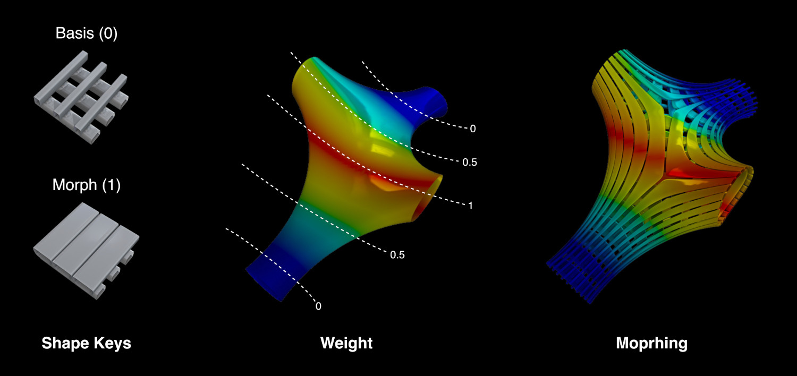

- **Map Vertex Groups**: transfers each vertex group of the Base mesh to the generated geometry.
- **Use Shape Keys**: transfers the shape keys of the Component object to the generated object. When the names of the Base's vertex groups match the shape keys, they are assigned automatically to drive the morphing. Watch the [tutorial](https://youtu.be/2Wcu9E0EGEM).

**Iterations**: repeats the tessellation, using the result of the previous iteration as the new base.

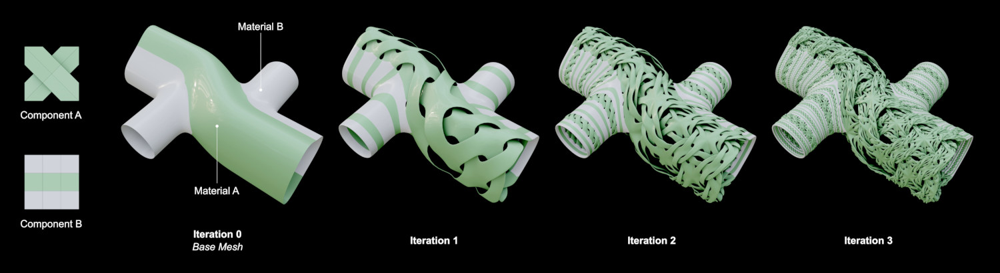

- **Repeat**: the number of iterations.
- **Combine Iterations**: combines the result with part or all of the previous iteration:
  - **Last**: ignores the previous iterations.
  - **Unused**: adds the faces of the previous iteration that did not generate components.
  - **All**: adds all the faces of the previous iteration.

### Dual Mesh

*Dual Mesh* turns the selected meshes into their dual meshes: polygonal meshes derived from a triangular mesh. Quad meshes are triangulated first.

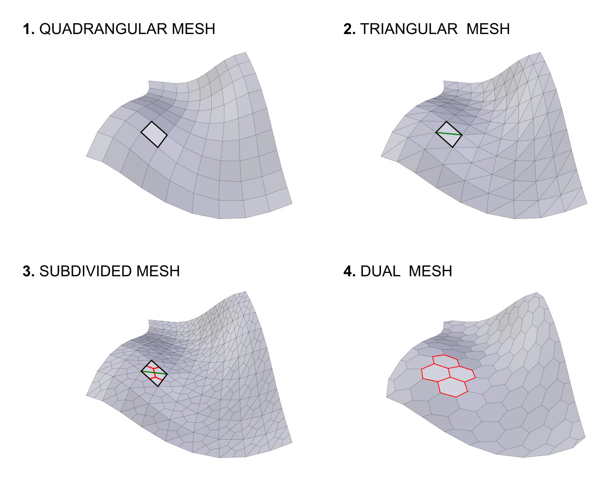

**Quad Method**: how quads are split into triangles (as in the *Triangulate Faces* tool).

**Polygon Method**: how polygons are split into triangles (as in the *Triangulate Faces* tool).

**Preserve Borders**: keeps the open boundaries of the mesh unchanged.

### Convert to Curve

Generates a Curve object from the *Loops*, *Edges* or *Particles* of the active object. The operation is non-destructive: at any moment you can reload the changes from the base object and change the parameters of the conversion. Specific edges or loops can be converted according to different criteria, and a pattern effect can be added.

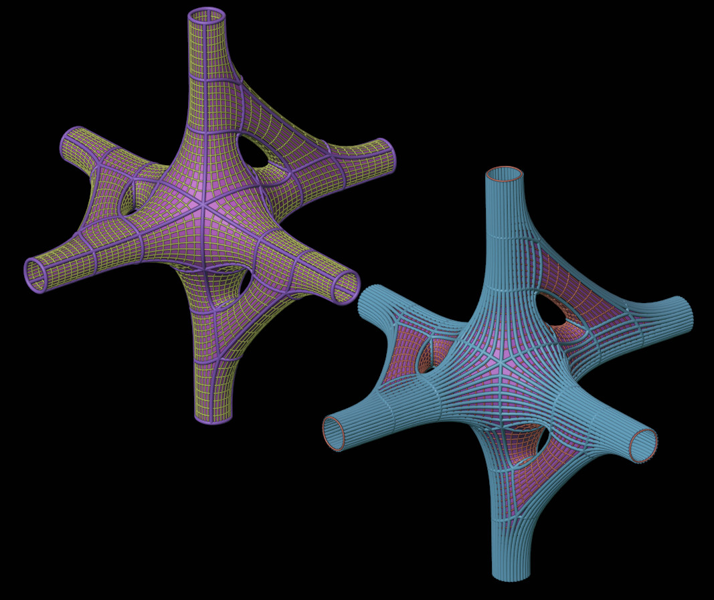

*Documentation to come.*

### Refresh

Updates the active object with the changes made to its input geometry. Works on objects generated by *Tessellate* and *Convert to Curve*.

### Rotate Faces

Rotates the vertex indices of the selected faces (in Edit Mode). This controls the rotation of the components of tessellated objects that use the *Default* rotation. The affected tessellated objects are refreshed automatically.

### Convert to Dual Mesh

The destructive version of *Dual Mesh*: converts the active object directly into its dual mesh.

### Polyhedra Wireframe

*Documentation to come.*

### Lattice Along Surface

*Documentation to come.* Watch the [tutorial](https://youtu.be/TCw_7HZv4zw).

### UV to Mesh

Converts the active UV map to a mesh, trying to preserve the total surface area of the original 3D model.

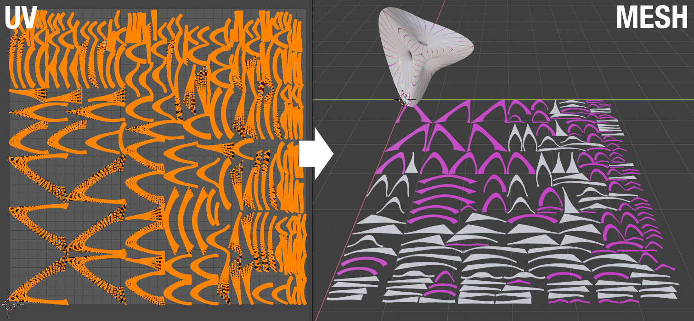

### Random Materials

Assigns random materials to the faces of the active mesh object.

### Weight to Materials

Distributes the existing materials according to the weight of the active vertex group. New materials can also be created automatically.

### Tissue Render Animation

*Documentation to come.*

## Tissue Weight Tools

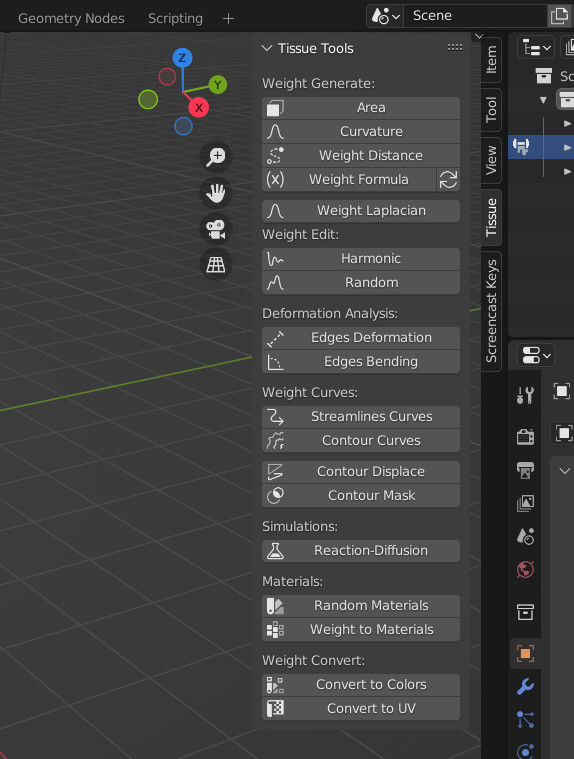

### Area

Assigns weight values based on the area of each face, with automatic or manual bounds.

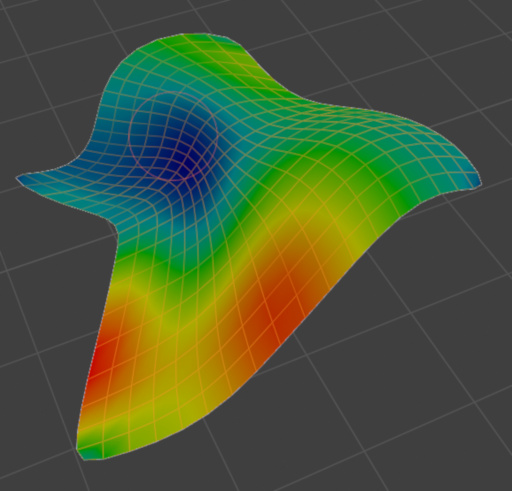

### Curvature

Weight from curvature, based on the *Dirty Colors* of the color attributes.

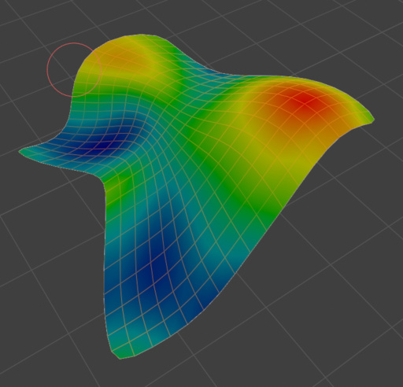

### Weight Distance

Generates a vertex group from the distance to the selected vertices. The distance can be *Geodesic*, *Euclidean* or *Topology*.

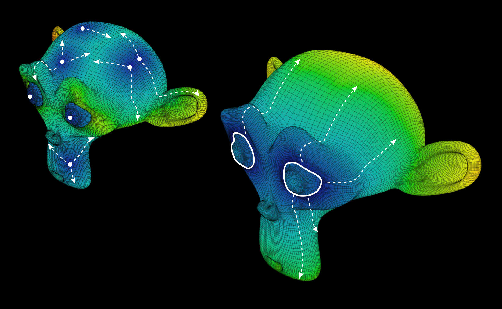

### Weight Formula

Weight from a formula of vertex parameters, such as vertex coordinates and normal directions. Integer and float sliders can be added to tune the parameters more easily.

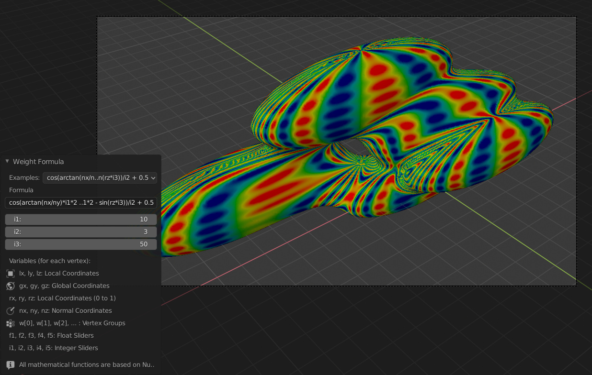

### Weight Laplacian

*Documentation to come.*

### Harmonic

A harmonic function based on the active weight.

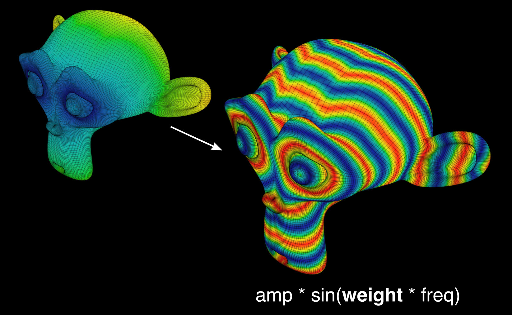

### Random

*Documentation to come.*

### Edges Deformation

Generates a vertex group from the deformation of the edges, evaluated on the result of the modifiers (deformation modifiers and simulations).

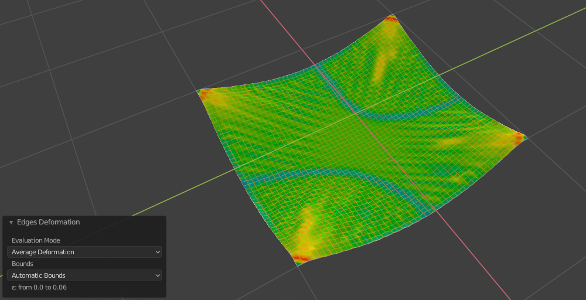

### Edges Bending

Generates a vertex group from the bending of the edges, evaluated on the result of the modifiers (deformation modifiers and simulations).

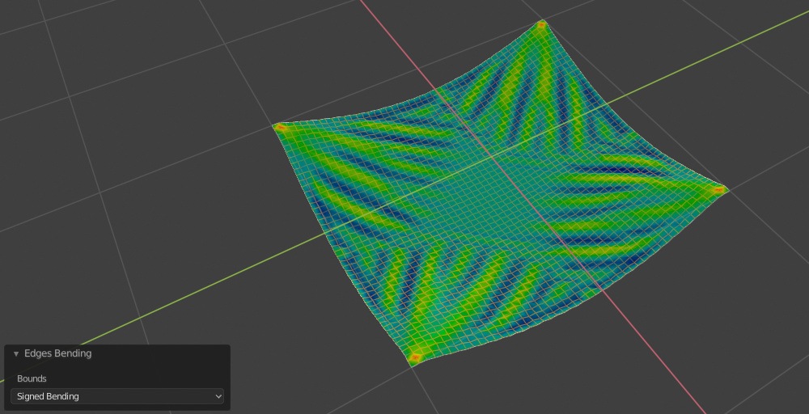

### Streamlines Curves

*Documentation to come.*

### Contour Curves

Generates isocurves from the active weight.

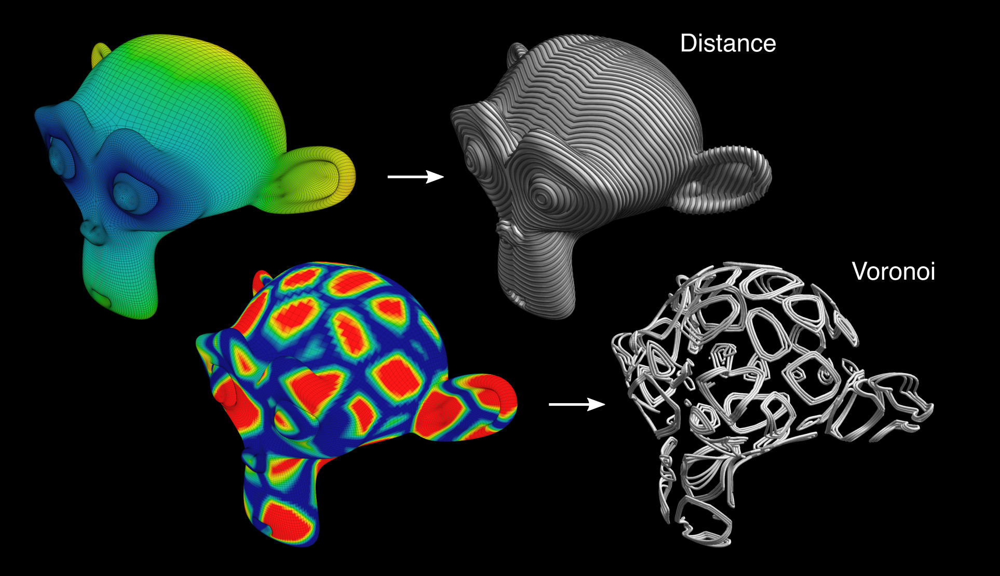

### Contour Displace

Cuts the mesh into a variable number of isocurves of the active weight, and adds a Displace modifier.

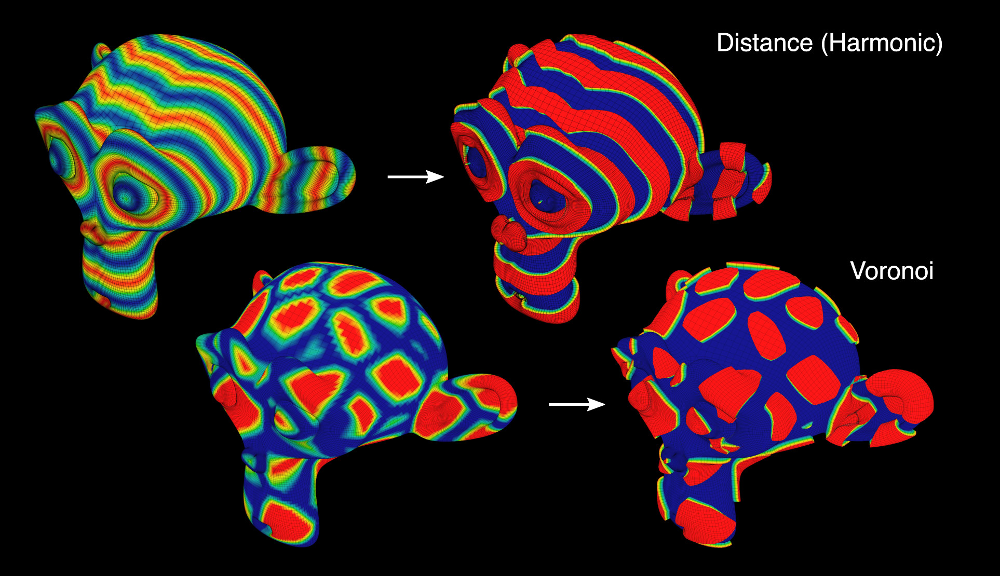

### Contour Mask

Trims the mesh according to the active weight.

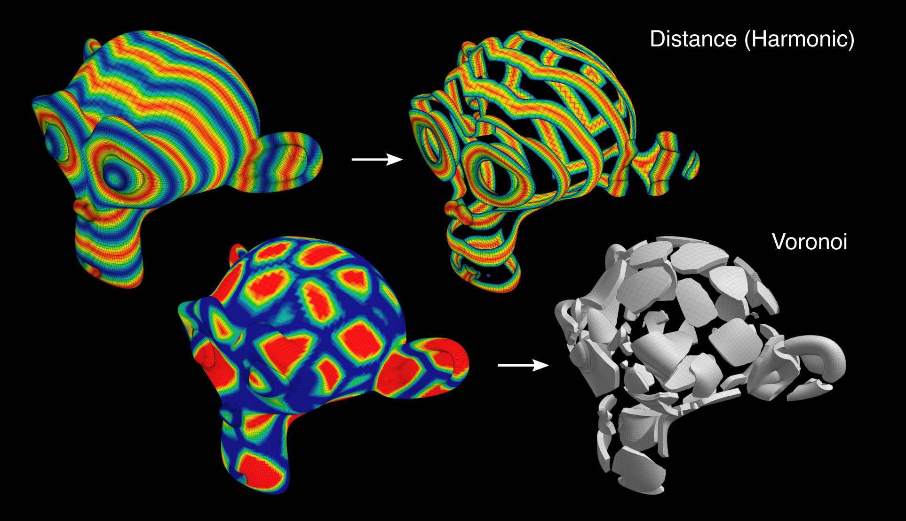

### Reaction Diffusion

Tissue implements the Gray-Scott model of [Reaction-Diffusion](https://en.wikipedia.org/wiki/Reaction%E2%80%93diffusion_system). It simulates, through vertex groups, the distribution of the two substances that generate the patterns of many living organisms.

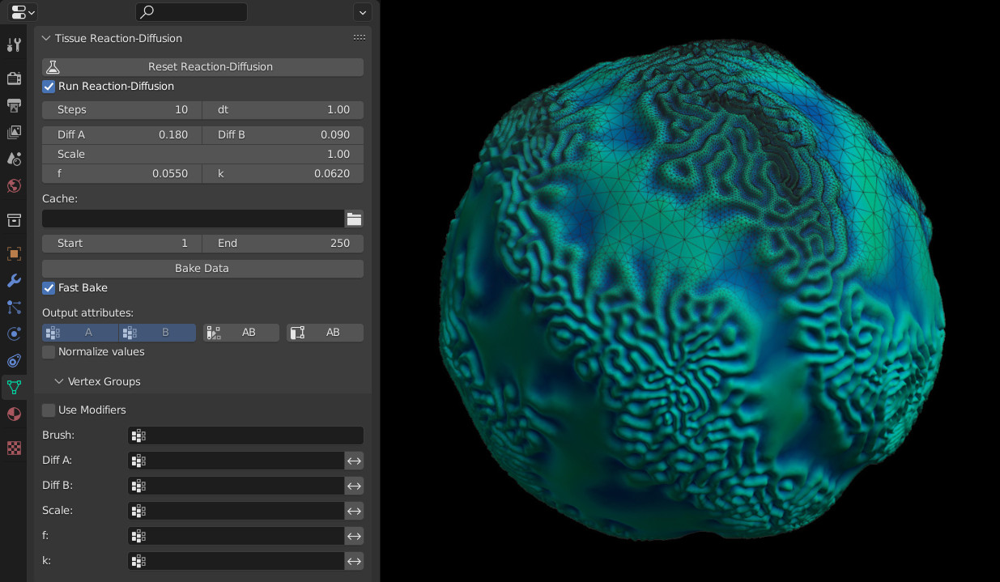

See [this video](https://youtu.be/J-0NzU1TmIY) for an example of the Reaction-Diffusion simulation with Tissue.

### Random Materials

*Documentation to come.*

### Weight to Materials

*Documentation to come.*

### Convert to Colors

**Convert To**: value channel, red channel, green channel, blue channel or false color.

**Invert**: inverts the values read from the vertex weights.

### Convert to UV

*Documentation to come.*

## Tissue Color Tools

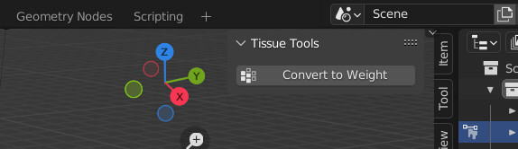

### Convert to Weight

**Red Channel**: adds a vertex group from the red channel of the active color attribute.

**Green Channel**: adds a vertex group from the green channel of the active color attribute.

**Blue Channel**: adds a vertex group from the blue channel of the active color attribute.

**Value Channel**: adds a vertex group from the value channel of the active color attribute.

**Invert**: inverts the values read from the color attribute.

## Video Tutorials

The full playlist is on [YouTube](https://www.youtube.com/playlist?list=PL4Eh7aUouWRCm4TNAr2qzg47l2wce1T7Y).

### Getting Started

\
*An introduction to tessellations: copying a component onto the faces of a base mesh.*

\
*A tour of the Tessellate operator and its settings.*

\
*Advanced tessellations: thickness, vertex groups and finer control over the pattern.*

### Tessellation Techniques

\
*Patch tessellation that follows a subdivided base and can be animated.*

\
*Components that change shape across the surface, driven by shape keys and vertex groups.*

\
*A different component for each material, for hard-surface modelling.*

\
*Cellular, Voronoi-like structures made with Dual Mesh.*

\
*Bending objects to follow a surface with Lattice along Surface.*

### Generative Systems

\
*L-systems: recursive growth through repeated tessellation.*

\
*Tree-like branching structures grown from components.*

\
*Organic patterns from Reaction-Diffusion on vertex groups.*

### Talks

\
*Tissue, a tool for computational design in Blender: a Blender Conference talk.*

\
*From computational design to digital fabrication with Tissue: a Blender Conference talk.*

## Credits

Tissue is developed by Alessandro Zomparelli ([Co-de-iT](https://www.co-de-it.com/)) and released under the GNU General Public License, version 3 or later.

This documentation is adapted from the Tissue page of the [Blender 4.1 Manual](https://docs.blender.org/manual/en/4.1/addons/mesh/tissue.html), © Blender Documentation Team, licensed under [CC BY-SA 4.0](https://creativecommons.org/licenses/by-sa/4.0/). This documentation is distributed under the same license.
